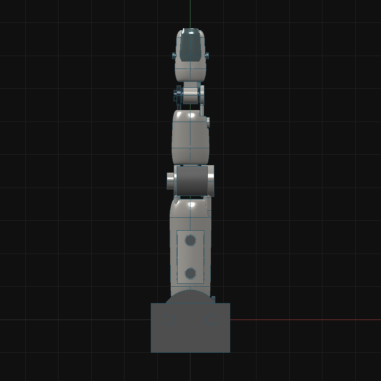
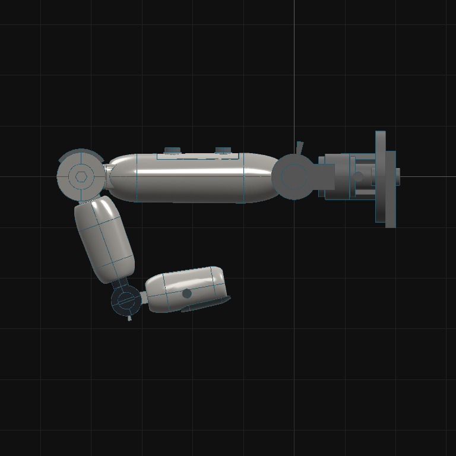
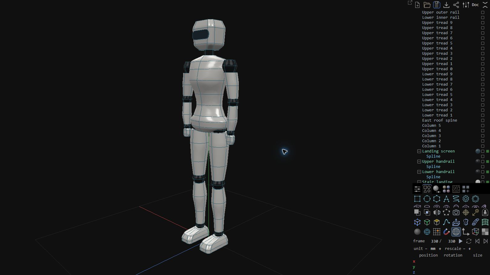
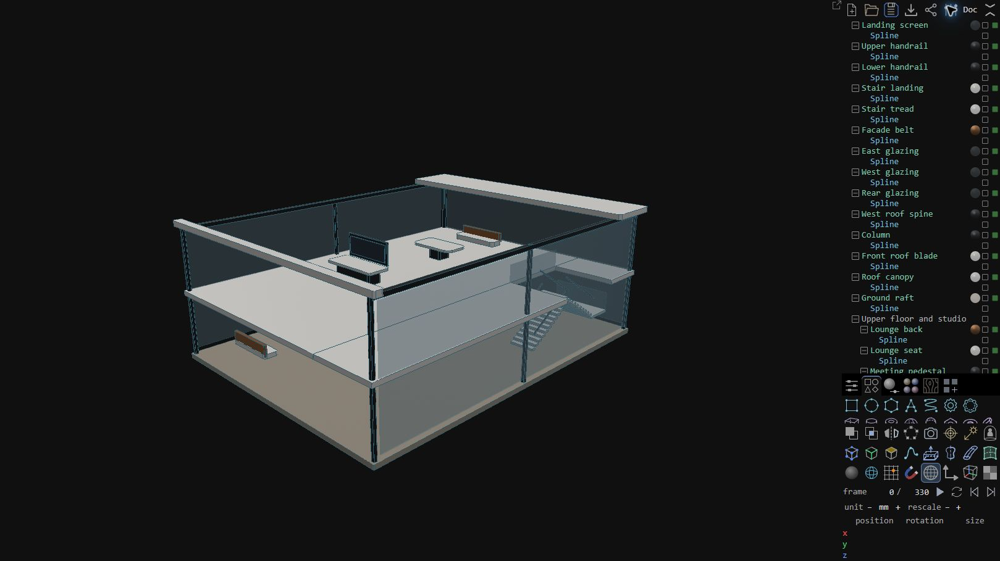

# Neira

## Analysis-scope correction (2026-11-18)

**The earlier motion/assembly analysis tracked 21 parts, not all 31 visible mesh parts in the saved v38 scene.** Ten MCP-related rivets, pins, liners, washers and a collar were omitted from that tracked set. Existing results remain valid only for their listed pairs and poses; they do not establish complete-assembly collision coverage. A fresh audit including the omitted parts is pending. This correction reports a coverage gap, not a newly found collision or proof of its absence.

The exact published HASH, embedded Doc, 200-geometry roundtrip and archive-recovery identity evidence are unchanged. [Scope correction and omitted parts](docs/Rigid-finger-v38-T1-C2-analysis-scope.md) takes precedence over historical wording that calls the 21-part set “all final bodies”.

## Current focused study: articulated rigid finger

The latest detailed work is a native editable finger study, not a finished robot or a production-ready hand. Open [rigid-finger-v38-T1-C2.hash](scenes/rigid-finger-v38-T1-C2.hash) in Frame. It combines articulated MCP/PIP/DIP joints, a removable service cover, a mounted functional nail and dorsal PIP shielding.

[Checkpoint and limits](docs/Rigid-finger-v38-T1-C2.md) · [Verification receipt](artifacts/rigid-finger-v38-T1-C2-check.json)





Native reopening, geometry identity, selected assembly paths and finite motion samples have been checked. Known overlapping microtriangles and sharp transitions remain: a successful native export or clean topology counters do not certify a clean solid. Continuous collision freedom, global wall thickness, manufacturing fits, loads, wear and safety are not qualified. The retained editable cages and control are in the HASH. The complete scripted rebuild archive is not included in this public checkpoint; the older `npm run build/check` below still applies to the historical whole-robot workflow, not this finger.

The humanoid direction remains the larger goal. Earlier whole-body/workshop scenes below are preserved as historical concepts, not replaced by the finger or represented as its qualification.

Neira is an engineering study of a mobile, two-arm robot and the workshop that could manufacture, assemble and maintain it. The robot is the reason for the workshop: each part should have an explicit manufacturing or purchasing route.

The first iteration is an editable packaging and kinematic model in [Frame](https://github.com/mozg4D/frame). It explores a wheeled body, two arms and a provisional manual tool interface. Mechanical strength, actuator sizing, stability, control hardware and manufacturing tolerances remain open engineering work.





## Previous whole-body humanoid and laboratory concept

Open [neira-humanoid-lab-v1.hash](scenes/neira-humanoid-lab-v1.hash) in Frame. The new direction is a feminine humanoid with legs and a spacious two-level laboratory, roughly300m2 gross perlevel. The upper stair opening leaves approximately284.09m2 of slab, not300m2 net usable area. Use Scene Control for the robot close-up, overall building and ground-floor cutaway.

[Design basis](docs/Humanoid-laboratory-concept.md) · [Verification](artifacts/humanoid-lab-check.json). Static appearance/spatial study only: walking, stair climbing, structural safety and construction readiness are unverified.

## Previous wheeled body and workshop candidate

Open [neira-form-study.hash](scenes/neira-form-study.hash) in Frame for the current 354-owner body/workshop design candidate. This includes coordinated tapered body shells, joint service ports, a full-height cabinet enclosure and a deeper assembly bench. See [stage notes](docs/Torso-bench-study.md) and [verification](artifacts/torso-bench-recovered-check.json). The older canonical engineering scene below is preserved separately.

## Start here

- [Design](docs/Design.md): intent, dimensions, interfaces, decisions and verification boundaries.
- [Tool interface](docs/Tool-interface.md): hub/register, mating cable guide, referenced hardware, manufacturing study and open fit/load questions. Embedded Doc combines Design and Tool interface in this order.
- [State](STATE.md): current artifacts, evidence, outstanding work and the next continuation step.
- [Working instructions](AGENTS.md): modeling, performance and collaboration rules.

The native scene uses Frame's Spline Patches, profiles, generators and Instances. [Model source](src/model.js) constructs the robot; [Scene Control source](src/control.js) exposes eight commanded joints and a reproducible timeline, including an exploded manual-tool interface. The authoritative editable scene is `C:\Neira\scenes\neira.hash`: open this file directly in your own Frame application. Authored source, parameters and verification records belong alongside it so another person or a later AI model can continue the work.

Part agents develop the [wrist hub](src/parts/wrist-hub.js) and [cable guide](src/parts/cable-guide.js) in separate pure factories. The main assembler owns [shared dimensions](src/interface.js), [cage helpers](src/cad.js) and [part collection](src/parts/index.js), then creates and verifies the complete Frame assembly. Parts use millimetres, a mating face at local Z = 0 and normal +Z; both current datums are placed at wrist Z = +6. All source JavaScript is included in the build/verification hash fence.

## Run locally

Use Node.js 22 or later and a local Frame checkout at commit `b19eaee0fb7a96fce00e4096d9b689a8d0c05a3e` or newer, with its browser/test dependencies installed. This baseline includes Neira's required object bindings and avoids redundant refresh passes when concurrent observers settle. `FRAME_ROOT` defaults to `C:\frame`; set it to your checkout when needed. The verification workflow uses hardware WebGPU at DPR 1 and loads no Frame plugins.

From the Neira directory:

```powershell
$env:FRAME_ROOT = 'C:\frame'
npm run serve
```

For an optional local Frame session, open [Frame on port 4317](http://127.0.0.1:4317/index.html) and load the canonical file. The server also exposes a read-only [neira.hash download alias](http://127.0.0.1:4317/neira.hash). Open Scene Control to exercise the home pose, reach pose, exploded tool, playback and individual joint controls. `NEIRA_PORT` changes the port if 4317 is occupied.

Build and verify in separate isolated browser sessions:

```powershell
npm run build
npm run check
```

Build creates a candidate under `work/candidate/`, embedding the composite Design + Tool-interface text and control source. It leaves the canonical scene in place. Check verifies the candidate, checks the canonical file's saved fingerprint, then promotes through an atomic file replacement and publishes reports under `artifacts/`. An observed external change to the canonical file blocks promotion. Inspect report results and source hashes before treating a scene as verified. The checks cover native authoring, geometry, persistence and commanded motion; mechanical and manufacturing qualification remain open.

The current revision-1 part-factory checkpoint passed build and focused native checks, with 90 authored owners, 57 evaluated surface occurrences, 24 replicas, 33 independent position buffers and 12,768 generated display triangles. It checked the hub/register, cable guide, hardware stacks, six local front driver approaches, native persistence, eight joint controls and ordered exploded view. Separate factories and their assembly datums have passed native integration checks. See [verification evidence](artifacts/verification.json) and [continuation state](STATE.md) for exact source revisions, scope and remaining engineering work. Fits, pin retention, material/grade selection, payload and physical manufacture remain unqualified.

This repository is intended for public development and a later article. A redistribution license has not yet been selected.


